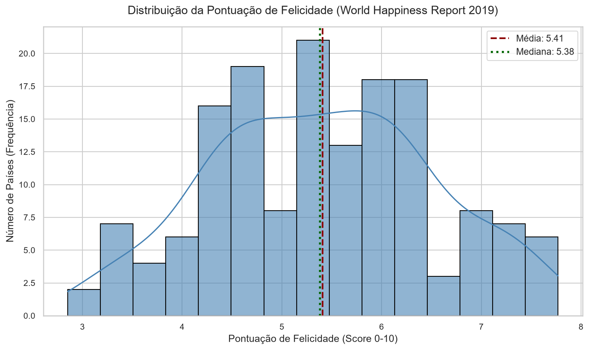
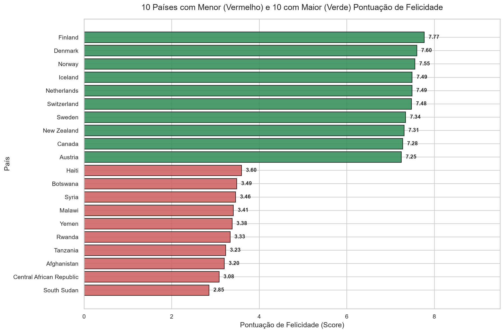
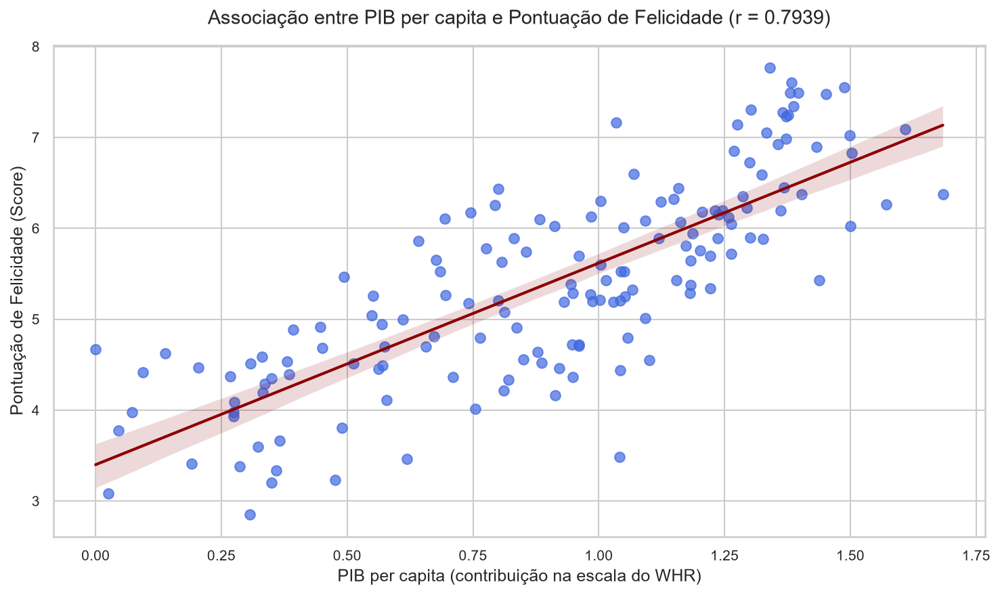
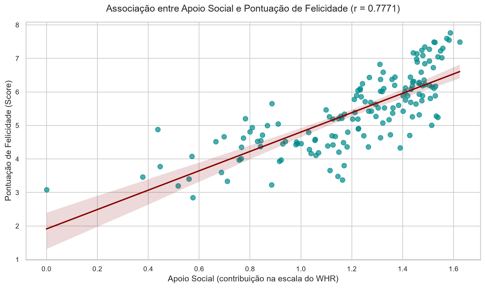
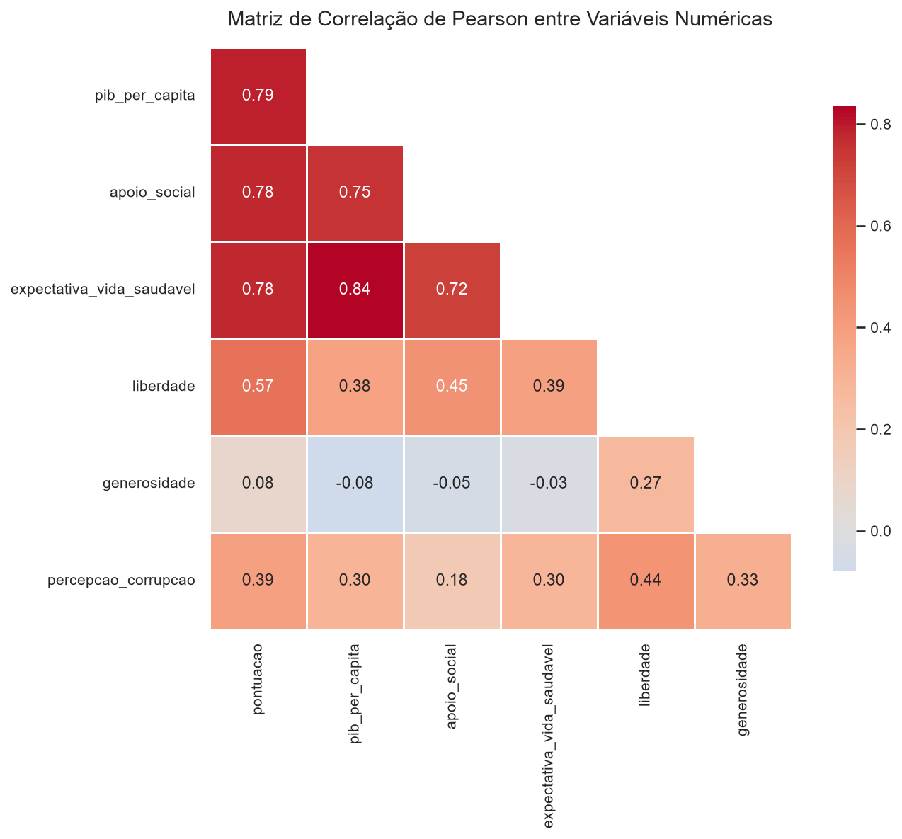
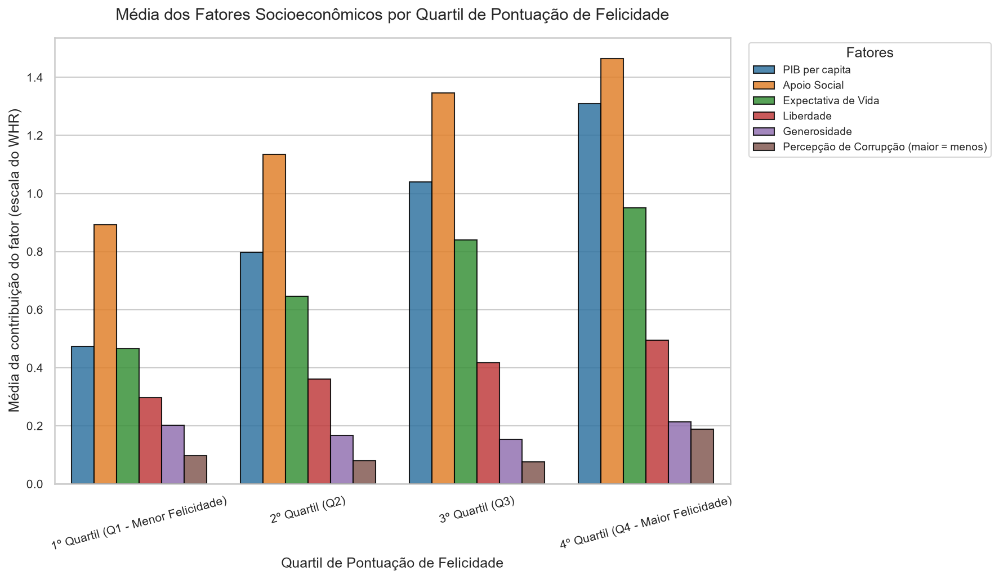

# Análise do World Happiness Report 2019 - SYNAPTA 2026

Desafio inicial SYNAPTA 2026, Edital nº 1/2026, UNINASSAU Maceió, Opção 2.

---

## 1. Introdução e Contexto
O presente repositório apresenta uma investigação estatística e visual dos fatores socioeconômicos e institucionais que compõem o bem-estar global no World Happiness Report de 2019. O estudo examina de forma descritiva e exploratória o corte transversal de 2019, englobando 156 países e territórios.

---

## 2. Pergunta Orientadora e Objetivo
- **Pergunta Orientadora**: Quais fatores aparecem associados às maiores pontuações de felicidade e quais cuidados devem ser tomados ao interpretar essa relação?
- **Objetivo**: Mapear a força da associação linear e monotônica entre a pontuação de felicidade global e os seis pilares metodológicos do relatório, documentando detalhadamente as limitações analíticas, as decisões de tratamento de dados e os cuidados metodológicos essenciais para evitar interpretações equivocadas de causalidade.

---

## 3. Dataset
- **Fonte Oficial**: [Kaggle - World Happiness Report (Gallup World Poll)](https://www.kaggle.com/datasets/unsdsn/world-happiness).
- **Arquivo Utilizado**: `2019.csv` (156 linhas, 9 colunas).
- **Nota de Licença e Versionamento**: Em respeito aos termos de uso do Kaggle e às boas práticas de engenharia de software, o dataset original **não** é versionado no Git (`data/raw/` está incluída no `.gitignore`).
- **Obtenção (Automática e Manual)**:
  - **Automática (Padrão)**: O script de ingestão (`src/01_ingestao_limpeza.py`) verifica se o arquivo `data/raw/2019.csv` existe localmente. Caso não exista, utiliza a biblioteca `kagglehub` para baixar o dataset automaticamente do Kaggle.
  - **Manual (Fallback)**: Caso ocorra alguma restrição de rede ou ambiente sem acesso à internet, o usuário pode baixar o arquivo `2019.csv` diretamente da [página do Kaggle](https://www.kaggle.com/datasets/unsdsn/world-happiness) e posicioná-lo em `data/raw/2019.csv`.

---

## 4. Dicionário de Colunas

| Nome Original (Kaggle) | Nome no Projeto (`snake_case`) | Descrição em Palavras Simples | Tipo de Dado |
| :--- | :--- | :--- | :--- |
| `"Overall rank"` | `"ranking"` | Posição do país no ranking mundial de felicidade (1 a 156). | Numérico Inteiro |
| `"Country or region"` | `"pais"` | Nome oficial do país ou região avaliada. | Texto (String) |
| `"Score"` | `"pontuacao"` | Pontuação média de felicidade percebida (escala de 0 a 10). | Numérico Decimal |
| `"GDP per capita"` | `"pib_per_capita"` | Contribuição estimada do PIB per capita para a pontuação de felicidade. | Numérico Decimal |
| `"Social support"` | `"apoio_social"` | Contribuição estimada de ter alguém com quem contar nos momentos de dificuldade. | Numérico Decimal |
| `"Healthy life expectancy"` | `"expectativa_vida_saudavel"` | Contribuição estimada da expectativa de vida saudável ao nascer. | Numérico Decimal |
| `"Freedom to make life choices"` | `"liberdade"` | Contribuição estimada da liberdade percebida para fazer escolhas de vida. | Numérico Decimal |
| `"Generosity"` | `"generosidade"` | Contribuição estimada das doações beneficentes recentes da população. | Numérico Decimal |
| `"Perceptions of corruption"` | `"percepcao_corrupcao"` | Contribuição estimada da percepção de corrupção no governo e nos negócios (valores maiores indicam *menor* percepção de corrupção). | Numérico Decimal |

---

## 5. Ferramentas e Tecnologias
- **Linguagem**: Python 3.10+
- **Manipulação e Análise de Dados**: `pandas`, `numpy`
- **Visualização Gráfica**: `matplotlib`, `seaborn`
- **Gerenciamento de Dados**: `kagglehub`
- **Organização de Caminhos**: `pathlib` (`Path`)

---

## 6. Estrutura do Repositório
```text
synapta_et1/
├── data/
│   ├── raw/                 # Armazena o arquivo 2019.csv (não versionado)
│   ├── processed/           # Armazena o dataset limpo (happiness_2019_limpo.csv)
│   └── README.md            # Instruções de obtenção do dataset
├── docs/
│   └── decisoes_de_limpeza.md # Relatório técnico de diagnóstico e limpeza
├── images/                  # Gráficos gerados (PNG, resolúção dpi=150)
│   ├── 01_distribuicao_pontuacao.png
│   ├── 02_top10_bottom10.png
│   ├── 03_pib_vs_felicidade.png
│   ├── 04_apoio_social_vs_felicidade.png
│   ├── 05_matriz_correlacao.png
│   └── 06_fatores_por_quartil.png
├── outputs/
│   ├── tables/              # Tabelas consolidadas em CSV (estatísticas, rankings, correlações, quartis)
│   ├── resumo_resultados.md # Resumo factual consolidado das análises
│   └── legendas_graficos.md # Catálogo completo de legendas dos gráficos
├── src/
│   ├── __init__.py
│   ├── config.py            # Configuração centralizada de caminhos e constantes
│   ├── 01_ingestao_limpeza.py # Pipeline de ingestão, diagnóstico, tratamento e validação
│   ├── 02_analises.py       # Pipeline de estatísticas descritivas, correlações e quartis
│   └── 03_graficos.py       # Pipeline de geração de plots e catálogo de legendas
├── .gitignore
├── requirements.txt
└── README.md
```

---

## 7. Como Executar
O projeto foi construído para execução modular e totalmente isolada. Siga o passo a passo abaixo:

1. **Clonar o repositório e navegar para a pasta raiz**:
   ```bash
   git clone <url-do-repositorio>
   cd synapta_et1
   ```

2. **Criar e ativar um ambiente virtual Python**:
   ```bash
   python -m venv venv
   # No Windows (PowerShell):
   .\venv\Scripts\Activate.ps1
   # No Linux / macOS:
   source venv/bin/activate
   ```

3. **Instalar as dependências do projeto**:
   ```bash
   pip install -r requirements.txt
   ```

4. **Executar o Pipeline de Ingestão e Limpeza** (o script fará o download automático via `kagglehub` caso o arquivo `data/raw/2019.csv` não exista localmente; caso prefira, você pode posicionar o arquivo manualmente em `data/raw/2019.csv`):
   ```bash
   python src/01_ingestao_limpeza.py
   ```

5. **Executar o Pipeline de Análises Estatísticas**:
   ```bash
   python src/02_analises.py
   ```

6. **Executar o Pipeline de Geração de Gráficos**:
   ```bash
   python src/03_graficos.py
   ```

---

## 8. Limpeza e Preparação dos Dados
O diagnóstico executado por `src/01_ingestao_limpeza.py` avaliou a integridade do dataset bruto. Os resultados detalhados encontram-se em [`docs/decisoes_de_limpeza.md`](docs/decisoes_de_limpeza.md):
- **Dimensões**: 156 linhas (países) e 9 colunas (variáveis) antes e depois do tratamento. Nenhum registro precisou ser removido por ausência de dados, preservando 100% da amostra.
- **Valores Ausentes**: 0 valores ausentes detectados.
- **Duplicatas**: 0 linhas duplicadas e 0 países duplicados.
- **Valores Inválidos**: 0 registros com pontuação fora da faixa oficial `[0, 10]` e 0 valores negativos nos fatores socioeconômicos.
- **Consistência de Ranking**: O ranking oficial revelou 2 países com pontuação idêntica (`5.208` para Marrocos e Azerbaijão). A validação utilizou ordenação estável para evitar dependência de ordens arbitrárias nos empates.
- **Padronização**: As colunas foram renomeadas de inglês para português `snake_case` através do dicionário centralizado em `src/config.py`.

---

## 9. Resultados

### 9.1 Estatísticas Descritivas da Pontuação
- **Total de países analisados**: 156
- **Média**: `5.4071`
- **Mediana**: `5.3795`
- **Desvio Padrão**: `1.1131`
- **Mínimo**: `2.8530` (South Sudan)
- **Máximo**: `7.7690` (Finland)
- **Diferença (Média - Mediana)**: `0.0276`

> **Explicação da Diferença**: A proximidade quase perfeita entre a média (`5.41`) e a mediana (`5.38`), com diferença de apenas `0.0276`, indica uma distribuição simétrica da pontuação de felicidade entre os países, sem distorções severas provocadas por valores atípicos (outliers).

### 9.2 Países nos Extremos (Top 10 e Bottom 10)

#### Top 10 Países com Maior Pontuação
| Ranking | País | Pontuação | PIB per capita | Apoio Social | Expectativa de Vida | Liberdade | Generosidade | Percepção de Corrupção |
| :---: | :--- | :---: | :---: | :---: | :---: | :---: | :---: | :---: |
| 1 | Finland | 7.769 | 1.340 | 1.587 | 0.986 | 0.596 | 0.153 | 0.393 |
| 2 | Denmark | 7.600 | 1.383 | 1.573 | 0.996 | 0.592 | 0.252 | 0.410 |
| 3 | Norway | 7.554 | 1.488 | 1.582 | 1.028 | 0.603 | 0.271 | 0.341 |
| 4 | Iceland | 7.494 | 1.380 | 1.624 | 1.026 | 0.591 | 0.354 | 0.118 |
| 5 | Netherlands | 7.488 | 1.396 | 1.522 | 0.999 | 0.557 | 0.322 | 0.298 |
| 6 | Switzerland | 7.480 | 1.452 | 1.526 | 1.052 | 0.572 | 0.263 | 0.343 |
| 7 | Sweden | 7.343 | 1.387 | 1.487 | 1.009 | 0.574 | 0.267 | 0.373 |
| 8 | New Zealand | 7.307 | 1.303 | 1.557 | 1.026 | 0.585 | 0.330 | 0.380 |
| 9 | Canada | 7.278 | 1.365 | 1.505 | 1.039 | 0.584 | 0.285 | 0.308 |
| 10 | Austria | 7.246 | 1.376 | 1.475 | 1.016 | 0.532 | 0.244 | 0.226 |

#### Bottom 10 Países com Menor Pontuação (ordenados do menor para o maior)
| Ranking | País | Pontuação | PIB per capita | Apoio Social | Expectativa de Vida | Liberdade | Generosidade | Percepção de Corrupção |
| :---: | :--- | :---: | :---: | :---: | :---: | :---: | :---: | :---: |
| 156 | South Sudan | 2.853 | 0.306 | 0.575 | 0.295 | 0.010 | 0.202 | 0.091 |
| 155 | Central African Republic | 3.083 | 0.026 | 0.000 | 0.105 | 0.225 | 0.235 | 0.035 |
| 154 | Afghanistan | 3.203 | 0.350 | 0.517 | 0.361 | 0.000 | 0.158 | 0.025 |
| 153 | Tanzania | 3.231 | 0.476 | 0.885 | 0.499 | 0.417 | 0.276 | 0.147 |
| 152 | Rwanda | 3.334 | 0.359 | 0.711 | 0.614 | 0.555 | 0.217 | 0.411 |
| 151 | Yemen | 3.380 | 0.287 | 1.163 | 0.463 | 0.143 | 0.108 | 0.077 |
| 150 | Malawi | 3.410 | 0.191 | 0.560 | 0.495 | 0.443 | 0.218 | 0.089 |
| 149 | Syria | 3.462 | 0.619 | 0.378 | 0.440 | 0.013 | 0.331 | 0.141 |
| 148 | Botswana | 3.488 | 1.041 | 1.145 | 0.538 | 0.455 | 0.025 | 0.100 |
| 147 | Haiti | 3.597 | 0.323 | 0.688 | 0.449 | 0.026 | 0.419 | 0.110 |

### 9.3 Associação entre Fatores e Pontuação (Correlações)
| Fator Socioeconômico | Correlação de Pearson ($r$) | Correlação de Spearman ($\rho$) |
| :--- | :---: | :---: |
| `pib_per_capita` | `0.7939` | `0.8145` |
| `expectativa_vida_saudavel` | `0.7799` | `0.8073` |
| `apoio_social` | `0.7771` | `0.8162` |
| `liberdade` | `0.5667` | `0.5520` |
| `percepcao_corrupcao` | `0.3856` | `0.2173` |
| `generosidade` | `0.0758` | `0.0705` |

### 9.4 Comparação por Quartis de Pontuação
| Quartil | Pontuação Média | PIB per capita | Apoio Social | Expectativa de Vida | Liberdade | Generosidade | Percepção de Corrupção |
| :--- | :---: | :---: | :---: | :---: | :---: | :---: | :---: |
| **1º Quartil (Q1 - Menor Felicidade)** | `4.0051` | `0.4734` | `0.8919` | `0.4651` | `0.2975` | `0.2029` | `0.0974` |
| **2º Quartil (Q2)** | `4.9763` | `0.7966` | `1.1343` | `0.6465` | `0.3605` | `0.1680` | `0.0790` |
| **3º Quartil (Q3)** | `5.8183` | `1.0405` | `1.3453` | `0.8393` | `0.4180` | `0.1540` | `0.0767` |
| **4º Quartil (Q4 - Maior Felicidade)** | `6.8287` | `1.3102` | `1.4638` | `0.9501` | `0.4943` | `0.2144` | `0.1893` |

---

## 10. Gráficos

### Gráfico 1: Distribuição da Pontuação de Felicidade

*Histograma com curva de densidade dos 156 países, com média (5.41) e mediana (5.38) muito próximas, sugerindo simetria.*

### Gráfico 2: 10 Países com Menor e 10 com Maior Pontuação

*Comparação entre os extremos da distribuição, com Finland (7.77) no topo e South Sudan (2.85) na base.*

### Gráfico 3: Associação entre PIB per capita e Pontuação

*Dispersão com linha de tendência linear indicando associação positiva forte entre PIB per capita e pontuação (r = 0.79).*

### Gráfico 4: Associação entre Apoio Social e Pontuação

*Dispersão com linha de ajuste linear indicando associação positiva forte entre apoio social e pontuação (r = 0.78).*

### Gráfico 5: Matriz de Correlação de Pearson

*Heatmap triangular com as correlações entre a pontuação e os seis fatores. A maior correlação entre dois fatores é `pib_per_capita` x `expectativa_vida_saudavel` (r = 0.84).*

### Gráfico 6: Média dos Fatores por Quartil de Pontuação

*Barras agrupadas com a média de cada fator em cada quartil de pontuação. Maioria dos fatores cresce do Q1 ao Q4, exceto `generosidade`, `percepcao_corrupcao`, que não crescem de forma contínua.*

---

## 11. Conclusões
1. **Forte Associação com Riqueza e Saúde**: O PIB per capita ($r = 0.7939$) e a expectativa de vida saudável ($r = 0.7799$) apresentam as maiores correlações lineares com a pontuação de felicidade global entre os países analisados.
2. **Importância do Apoio Social**: O apoio social acompanha de perto os líderes, registrando correlação de Pearson de $r = 0.7771$ e média crescente do Q1 (`0.8919`) ao Q4 (`1.4638`).
3. **Generosidade Praticamente Descorrelacionada**: A generosidade apresentou correlação linear quase nula com a pontuação ($r = 0.0758$), indicando que o indicador do relatório não se associa de forma linear ao nível nacional de felicidade.
4. **Comportamento Não Monotônico de Fatores**: Enquanto PIB, apoio social, expectativa de vida e liberdade crescem monotonicamente do Q1 ao Q4, generosidade e percepção de corrupção apresentam oscilações entre os quartis intermediários (ver tabela de quartis na seção 9.4).
5. **Amplitude Extrema Global**: Há uma diferença de `4.916` pontos entre a Finlândia (`7.769`) e o Sudão do Sul (`2.853`), evidenciando disparidades estruturais expressivas no bem-estar percebido entre os extremos da amostra de 156 países.

---

## 12. Correlação Não é Causalidade
A análise estatística realizada baseia-se em dados de corte transversal (cross-sectional) de 2019 e mede exclusivamente **associação estatística** (coeficientes de Pearson e Spearman), **não comprovando relação de causa e efeito**. 
- **Exemplo 1 (PIB per capita)**: Embora países com maior PIB per capita apresentem maior pontuação média de felicidade ($r = 0.7939$), injetar recursos financeiros de forma isolada em um país não garante automaticamente o aumento da felicidade da população, pois o PIB é correlacionado a múltiplos fatores omitidos (qualidade institucional, segurança pública, estabilidade política).
- **Exemplo 2 (Construção Aditiva do Indicador)**: No World Happiness Report, os fatores representam contribuições estimadas para a pontuação (a soma dos seis fatores possui correlação de $r = 0.8799$ com o score). Parte da associação observada decorre da própria engenharia de construção do indicador do relatório, e não de medições independentes.

---

## 13. Limitações
- **Natureza Transversal**: Os dados representam um retrato estático do ano de 2019, impossibilitando análises de causalidade temporal ou painel.
- **Escala Subjetiva e Diferenças Culturais**: A pontuação de felicidade baseia-se na pergunta Cantril Ladder (autoavaliação de vida de 0 a 10), que sofre influência de normas culturais, expectativas sociais e interpretações linguísticas distintas entre países.
- **Unidade de Análise Nacional**: O estudo analisa países como unidades agregadas, o que mascara profundas desigualdades internas de renda, bem-estar e acesso a serviços dentro de cada nação.
- **Direção da Percepção de Corrupção**: No dataset original, valores mais altos na variável de corrupção indicam *menor* percepção de corrupção, exigindo cuidado redobrado na leitura dos coeficientes positivos.

---

## 14. Declaração de Uso de Inteligência Artificial Generativa
Este projeto utilizou assistência de Inteligência Artificial Generativa (Claude, desenvolvido pela Anthropic) para o planejamento estrutural, revisão conceitual e redação de rascunhos de código e documentação. A execução técnica, validação dos scripts, depuração e auditoria final foram realizadas pelo autor com o auxílio do agente OpenCode.

Para fins de transparência e verificação acadêmica, o autor declara que realizou pessoalmente as seguintes checagens:
- [✅] Li e compreendi cada linha de código dos scripts em `src/`.
- [✅] Conferi os números das tabelas geradas (`outputs/tables/`) contra a saída de execução do terminal.
- [✅] Revisei criticamente a interpretação dos gráficos e as conclusões apresentadas neste README.

---
*Desafio Inicial SYNAPTA 2026 - UNINASSAU Maceió.*
